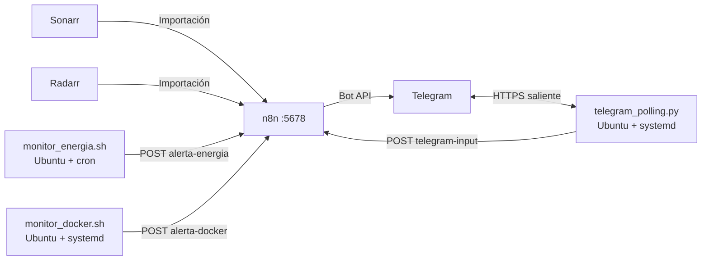

# Papulap67: mi homelab en una laptop

Convertí una laptop en un servidor casero para concentrar mis servicios, automatizar mi biblioteca multimedia y aprender a administrar infraestructura propia. La base es **Ubuntu Server + Docker + CasaOS**. Accedo a la máquina por SSH en mi red local y mediante **Tailscale** cuando estoy fuera de casa. Para los avisos y consultas construí varios flujos con **n8n** y un bot de Telegram al que llamé **Papubot**.

Este documento cuenta el progreso del proyecto en orden aproximado, incluye las decisiones que cambié sobre la marcha y distingue lo que ya probé de las mejoras que todavía debo verificar. Las rutas y direcciones corresponden a mi instalación; no incluyo contraseñas, tokens ni mi Chat ID.


*La laptop que mantengo encendida para alojar los servicios del homelab.*

## Índice

1. [Objetivos y estado actual](#objetivos-y-estado-actual)
2. [Preparación de la laptop](#preparación-de-la-laptop)
3. [CasaOS y servicios en Docker](#casaos-y-servicios-en-docker)
4. [Acceso remoto con Tailscale](#acceso-remoto-con-tailscale)
5. [Disco externo, multimedia y respaldos](#disco-externo-multimedia-y-respaldos)
6. [Arquitectura de las automatizaciones](#arquitectura-de-las-automatizaciones)
7. [Automatización 1: descargas de Sonarr y Radarr](#automatización-1-descargas-de-sonarr-y-radarr)
8. [Automatización 2: energía, batería y temperatura](#automatización-2-energía-batería-y-temperatura)
9. [Automatización 3: contenedores Docker](#automatización-3-contenedores-docker)
10. [Automatización 4: Papubot interactivo](#automatización-4-papubot-interactivo)
11. [Otros servicios e ideas](#otros-servicios-e-ideas)
12. [Problemas que resolví](#problemas-que-resolví)
13. [Operación, seguridad y próximos pasos](#operación-seguridad-y-próximos-pasos)

## Objetivos y estado actual

Mis objetivos iniciales fueron reutilizar hardware que ya tenía, aprender Linux y Docker, tener control directo de mis datos y acceder al servidor desde fuera de casa sin abrir puertos en el router. Después amplié el proyecto con almacenamiento externo, servicios multimedia, domótica y automatizaciones de monitoreo.

| Componente | Para qué lo uso | Estado documentado |
|---|---|---|
| Ubuntu Server y OpenSSH | Sistema base y administración remota | Instalados |
| CasaOS y Docker | Panel visual y despliegue de aplicaciones | En uso |
| Tailscale | Acceso privado fuera de la LAN | Configurado |
| Disco externo ext4 | Descargas, películas, series y respaldos | Montado; mapeo de qBittorrent comprobado |
| Sonarr, Radarr, qBittorrent y Jellyfin | Gestión y reproducción multimedia | En el entorno; alerta de Sonarr probada |
| n8n y Papubot | Flujos, notificaciones y comandos | En uso; algunas ramas aún requieren prueba final |
| Monitor de energía | Avisos de pérdida y regreso de corriente | Ambos avisos básicos probados |
| Monitor Docker | Avisos por evento `die` | Alerta de un contenedor de prueba observada |
| Vaultwarden, Pi-hole e Immich | Contraseñas, DNS y fotografías | Instalados según el registro del proyecto; configuración completa por documentar |
| Homepage y Home Assistant | Tablero y domótica | Tratados durante el proyecto; ajustes finales por documentar |
| Coolify y PostgreSQL | Despliegues y base de datos propia | Explorados; no doy la base de datos por terminada |
| Cámaras Wyze | Integración local con Home Assistant | Idea pendiente |

Mi servidor se llama `Papulap67`, el usuario principal de Ubuntu es `tu_usuario` y la dirección que fijé en mi LAN es `192.168.1.X`. Los puertos que aparecen más adelante son los que usé o consideré durante la configuración; verificaré el inventario definitivo directamente en Docker cuando actualice este README.

## Preparación de la laptop

### Instalación de Ubuntu Server

Empecé desde cero con una memoria USB booteable de Ubuntu Server. Instalé el sistema en la laptop, creé la cuenta `tu_usuario` y dejé la máquina dedicada al homelab. Elegí Ubuntu Server para evitar una interfaz gráfica permanente y administrar los servicios por terminal, SSH y paneles web.

### Dirección local y acceso SSH

Asigné la IP local **`192.168.1.X`** para que los enlaces a CasaOS, Sonarr, n8n y los demás servicios no cambien después de un reinicio. Habilité **OpenSSH** para administrar Ubuntu desde otra computadora sin depender de teclado y pantalla conectados a la laptop.

También modifiqué `/etc/systemd/logind.conf` para que cerrar la tapa no suspendiera el servidor:

```ini
HandleLidSwitch=ignore
```

Esto es importante en una laptop usada como servidor: una suspensión automática interrumpiría los contenedores, las descargas y los monitores.

### La batería como respaldo temporal

La batería integrada me da un margen durante un corte de corriente o si se desconecta el cargador. No reemplaza por completo a un SAI/UPS para toda la red: si el módem o router se apaga, la laptop puede seguir encendida pero no podrá enviar avisos a Telegram hasta que vuelva la conectividad. Más adelante aproveché esa batería para detectar los cambios de alimentación.

## CasaOS y servicios en Docker

Instalé CasaOS desde SSH con el comando oficial que utilicé en esta fase:

```bash
curl -fsSL https://get.casaos.io | sudo bash
```

Después pude entrar al panel desde `http://192.168.1.X`. CasaOS me permitió gestionar aplicaciones Docker desde una interfaz visual, incluidos sus volúmenes y puertos. Docker mantiene los servicios separados del sistema base y facilita reiniciarlos o actualizar su configuración.

### Servicios principales

| Servicio | Dirección usada en mi LAN | Función |
|---|---|---|
| CasaOS | `http://192.168.1.X` | Panel principal |
| n8n | `http://192.168.1.X:5678` | Automatizaciones; desde Ubuntu uso `127.0.0.1:5678` |
| Sonarr | `http://192.168.1.X:8989` | Series y anime |
| Radarr | `http://192.168.1.X:7878` | Películas |
| Jellyfin | `http://192.168.1.X:8096` | Biblioteca y reproducción multimedia |
| Homepage | `http://192.168.1.X:3000` | Tablero de accesos |
| Home Assistant | `http://192.168.1.X:8123` | Domótica |
| Coolify | `http://192.168.1.X:8000` | Despliegue de proyectos y bases de datos |

También instalé o traté en el proyecto qBittorrent, Vaultwarden, Pi-hole e Immich. Aún me falta publicar en este repositorio una tabla con la versión, imagen Docker, volumen y puerto exactos de **cada** contenedor. Prefiero dejar esos valores pendientes antes que registrar configuraciones que quizá hayan cambiado.


*Vista del panel de CasaOS. En la captura se aprecian, entre otros, qBittorrent, Pi-hole, Vaultwarden, Homepage, Immich y n8n.*

### La reinstalación de n8n

Intenté configurar n8n manualmente con Docker Compose en `/DATA/AppData/n8n`. Al acceder por HTTP local apareció un problema relacionado con la cookie de sesión segura. Consideré una configuración con `N8N_SECURE_COOKIE=false`, pero decidí retirar aquella instalación manual y volver a instalar n8n desde la **App Store de CasaOS**, que antes me había permitido abrirlo y crear la cuenta sin ese conflicto.

Por eso **no tomo el Compose manual como la configuración actual**. Los workflows descritos aquí pertenecen a la instalación posterior desde CasaOS. El puerto publicado continuó siendo `5678`.

## Acceso remoto con Tailscale

Instalé Tailscale en Ubuntu con:

```bash
curl -fsSL https://tailscale.com/install.sh | sh
sudo tailscale up
```

Vinculé la laptop a mi red personal de Tailscale. El equipo recibió una dirección privada del rango `100.x.x.x`, con la que puedo llegar a los servicios autorizados desde otro dispositivo conectado a esa misma red, aun fuera de casa. Este enfoque me evitó configurar redirecciones de puertos en el router o publicar CasaOS, SSH y n8n directamente en Internet.

Tailscale resuelve el **acceso administrativo remoto**. Los avisos de Papubot funcionan por la conexión saliente de la laptop con la API de Telegram; no dependen de que mi teléfono esté conectado a Tailscale.

Además del acceso por terminal, configuré el uso del **escritorio remoto (RDP)** para abrir el entorno gráfico de Ubuntu desde mi computadora personal. Así puedo administrar el servidor aunque la laptop permanezca sin monitor, teclado ni mouse conectados (modo *headless*). La captura muestra una sesión remota iniciada a través de la dirección privada de Tailscale; no tuve que publicar el escritorio en Internet.


*Sesión gráfica remota al servidor. La dirección visible corresponde a la red privada de Tailscale.*

## Disco externo, multimedia y respaldos

### Formato y montaje permanente

Preparé un disco externo en **ext4**, con la etiqueta `AlmacenExterno`, y lo monté en `/mnt/externo`. Usé su UUID en `/etc/fstab` en lugar de depender de un nombre cambiante como `/dev/sdb1`:

```fstab
UUID=<UUID_DE_MI_DISCO> /mnt/externo ext4 defaults,nofail 0 2
```

La opción `nofail` evita que Ubuntu se quede detenido durante el arranque si el disco no está conectado. Probé el montaje con `sudo mount -a` y consulté `lsblk -f`. Organicé el contenido bajo rutas como estas:

```text
/mnt/externo/
├── Backups/
└── Multimedia/
    ├── Downloads/
    ├── Movies/
    └── TV Shows/
```

En la fase inicial también ajusté propietario y permisos para que mi usuario y los contenedores pudieran escribir en el disco. Antes de repetir cambios recursivos de permisos en una instalación nueva revisaría primero el propietario y los grupos de cada volumen.


*La salida identifica el volumen `AlmacenExterno` y confirma el punto de montaje `/mnt/externo`.*

### Una corrección importante en qBittorrent

Durante una prueba vi que las descargas seguían ocupando el SSD interno. Creía haber cambiado `/downloads` desde el panel de CasaOS, pero no había guardado la modificación. Lo confirmé comparando dos salidas de `docker inspect qbittorrent`:

| Ruta dentro de qBittorrent | Mapeo anterior | Mapeo después de guardar |
|---|---|---|
| `/config` | `/DATA/AppData/qbittorrent/config` | Igual |
| `/downloads` | `/DATA/Downloads` | `/mnt/externo/Multimedia/Downloads` |
| `/movies` | `/mnt/externo/Multimedia/Movies` | Igual |
| `/tvshows` | `/mnt/externo/Multimedia/TV Shows` | Igual |

La comprobación que me permitió detectar el problema fue:

```bash
docker inspect qbittorrent --format '{{range .Mounts}}{{.Source}} -> {{.Destination}}{{println}}{{end}}'
```

Aprendí a distinguir las rutas del **host** de las rutas **dentro del contenedor**. En qBittorrent, la ruta predeterminada de descarga y la categoría `tv-sonarr` debían apuntar a `/downloads`. En Sonarr también debía revisar la carpeta raíz de las series añadidas antes de la migración; algunas podían seguir guardando una ruta antigua en `/DATA/Media/TV Shows` aunque Docker ya tuviera el volumen nuevo. Una descarga creada antes del cambio tampoco adopta automáticamente la ruta nueva.

### Respaldos con Restic

Incluí `/mnt/externo/Backups` para un repositorio de respaldos cifrados con **Restic**. En mis notas del proyecto figura una ejecución nocturna a las **03:00**. Me falta incorporar aquí la configuración exacta del trabajo, la retención y, sobre todo, una **restauración de prueba**. No quiero llamar «respaldo verificado» a una tarea solo porque esté programada. También debo comprobar cómo se respaldan de forma consistente las bases de datos si termino desplegando PostgreSQL.

## Arquitectura de las automatizaciones

Usé n8n como orquestador y Papubot como canal de notificaciones. Los eventos que solo puede observar Ubuntu —por ejemplo, sensores de energía o eventos de Docker— los procesa un script en el host y los entrega a n8n por un webhook local.



El flujo multimedia quedó organizado con un `Webhook`, un `Switch` y tres salidas hacia Telegram, una para películas, otra para temporadas completas y otra para episodios individuales.


Al principio exploré leer sensores con `Execute Command` dentro de n8n y montar rutas `/sys` en el contenedor. La instalación real presentó limitaciones por aislamiento o disponibilidad de ese nodo, así que para la solución posterior preferí scripts ligeros ejecutándose directamente en Ubuntu.

## Automatización 1: descargas de Sonarr y Radarr

### Qué quería recibir

Mi primer objetivo fue recibir un aviso cuando Sonarr importara un episodio y, después, ampliar el flujo para diferenciar:

1. Un episodio individual de una serie o anime en emisión.
2. Una temporada completa o un pack con varios episodios.
3. Una película gestionada por Radarr.

Quería que el mensaje mostrara, según el caso, título, temporada, episodio, cantidad de capítulos, calidad, archivo o ruta. También exploré incluir géneros, estudio/red de animación, duración y sinopsis cuando el evento realmente trajera esos campos.

### Webhook y enrutamiento

Sonarr y Radarr envían un evento HTTP a n8n. Durante las pruebas trabajé con `http://192.168.1.X:5678/webhook-test/sonarr-anime`; para producción, con `http://192.168.1.X:5678/webhook/sonarr-anime`. En algunos resúmenes posteriores apareció el nombre genérico `/webhook/media`, pero **el path que debo consultar es el guardado en el workflow actual** y el configurado en ambos gestores. No son nombres intercambiables.

Dentro de n8n conecté el Webhook a un nodo `Switch` y separé los eventos por contenido del JSON:

```text
Webhook
  └─ Switch
       ├─ body.movie existe                 → película
       ├─ body.episodes.length > 1         → temporada o pack
       └─ body.episodes.length == 1        → episodio individual
```

Dos expresiones que usé como base fueron:

```javascript
{{ $json.body.movie ? true : false }}
{{ $json.body.episodes ? $json.body.episodes.length : 0 }}
```

En la regla de episodios configuré la comparación como **número** (`#`), no como texto (`T`). La longitud de `episodes` devuelve un número y una comparación estricta con una cadena puede enviar el evento a la rama equivocada.

En Sonarr tuve que diferenciar `On Grab` de `On File Import`/`On Import Complete`. `On Grab` sucede cuando comienza la descarga; para mi aviso de «archivo listo» necesitaba el evento de importación. También consideré avisos por mejora de calidad (`On File Upgrade`). En Radarr configuré el webhook de importación de películas hacia el mismo flujo.

### La diferencia entre prueba y producción en n8n

Me confundió que el nodo Webhook volviera a mostrar la pestaña **Test URL** cada vez que lo abría. Aprendí que esas pestañas solo muestran dos direcciones: no son un interruptor que cambie el estado del workflow.

- `Listen for test event` o `Execute step` escucha temporalmente en `/webhook-test/...`.
- Un workflow guardado y **Published** recibe eventos en `/webhook/...`.
- Cambiar la pestaña visual no cambia el destino que Sonarr o Radarr tienen guardado.

También tuve que unir visualmente los nodos en el lienzo; tener el Webhook y Telegram colocados uno junto al otro no creaba automáticamente el flujo de datos.

### La prueba con *Mr. Robot*

Descargué una temporada de *Mr. Robot* y no llegó ningún mensaje. Eso me ayudó a revisar dos clases de fallas: una ejecución roja en n8n indicaría que llegó el evento pero falló un nodo; la ausencia de ejecuciones apuntaría al webhook, al disparador o a la URL de producción.

La plantilla inicial de la rama de temporada intentaba usar:

```javascript
{{ $json.body.series.genres.join(', ') }}
```

Ese campo no estaba disponible en el evento de descarga que estábamos procesando. Al llamar a `.join()` sobre un valor ausente, el nodo podía fallar antes de llegar a Telegram. Simplifiqué la plantilla para usar datos presentes en el evento: `series.title`, `episodes[0].seasonNumber`, `episodes.length` y `series.path`. Después **sí recibí el mensaje** correspondiente a la temporada. Esa prueba confirma la rama corregida; todavía debo guardar pruebas independientes de una película real y de un episodio individual.

### Campos y formatos que trabajé

Para la rama de **temporada o pack**, la versión simplificada que dejé como base evita los campos opcionales que provocaron el error:

```text
🎉 ¡Temporada / Pack descargado!
📺 Serie: {{ $json.body.series.title }}
📂 Temporada: {{ $json.body.episodes[0].seasonNumber }}
🔢 Episodios: {{ $json.body.episodes.length }} capítulos importados
📁 Carpeta: {{ $json.body.series.path }}
```

Para un **episodio individual** preparé una plantilla que contempla que `episodeFile` falte en ciertos eventos:

```text
🍿 ¡Nuevo episodio disponible!
📺 Serie: {{ $json.body.series.title }}
📌 Episodio: T{{ $json.body.episodes[0].seasonNumber }}E{{ $json.body.episodes[0].episodeNumber }} - {{ $json.body.episodes[0].title }}
🎞️ Calidad: {{ $json.body.episodeFile ? $json.body.episodeFile.quality : 'Completado' }}
📦 Archivo: {{ $json.body.episodeFile ? $json.body.episodeFile.relativePath : 'Importado' }}
```

Para **películas** exploré los campos `movie.title`, `movie.year`, `movie.runtime`, `movie.genres`, `movieFile.quality`, `movieFile.relativePath` y `movie.overview`. El payload concreto de Radarr puede variar por evento y versión, así que necesito una importación real antes de dar esa plantilla por cerrada. La misma precaución aplica a géneros, estudio o red de una serie: solo mostraré esos datos si el JSON recibido los incluye.

## Automatización 2: energía, batería y temperatura

### Detección desde Ubuntu

La batería de la laptop me permitió monitorizar si el cargador pierde y recupera corriente. La implementación posterior del proyecto usa `~/monitor_energia.sh` en Ubuntu. El script consulta:

```text
/sys/class/power_supply/A*/online      # Estado del cargador
/sys/class/power_supply/BAT*/capacity  # Porcentaje de batería
/sys/class/thermal/thermal_zone0/temp # Temperatura del procesador
```

Guarda el último estado observado en `/tmp/ultimo_estado_ac` para no enviar una alerta idéntica cada minuto y llama a n8n por `POST /webhook/alerta-energia`. La ejecución periódica descrita para mi crontab es:

```cron
* * * * * /bin/bash /home/tu_usuario/monitor_energia.sh >/dev/null 2>&1
```

No publico aquí una copia supuestamente exacta de `monitor_energia.sh` porque aún no he incorporado el archivo real del servidor al repositorio. Sí pude probar el resultado básico: **Papubot me avisó cuando faltó corriente y cuando regresó**.

### Clasificación del evento en n8n

El Webhook recibe al menos `mensaje`, `bateria` y `temperatura`. Diseñé un nodo `If` que comprueba si `{{ $json.body.mensaje }}` contiene `SE FUE LA LUZ`. La salida verdadera representa el corte; la otra se usó para el restablecimiento. En el aviso de Telegram incluyo el estado, el nivel de batería y la temperatura:

```javascript
{{ $('Webhook').item.json.body.mensaje }}
{{ $('Webhook').item.json.body.bateria }}
{{ $('Webhook').item.json.body.temperatura }}
```

Después planteé una mejora visual: que cada rama envíe un GIF distinto con esos datos en el `Caption`. La selección aleatoria usa una lista de URLs y `Math.floor(Math.random() * lista.length)`. Tengo documentadas dos listas, una de alerta y otra de recuperación, pero **todavía no considero probadas ambas ramas con GIF** porque no quedó registrada una verificación posterior al cambio. Para probar sin desconectar físicamente el cargador, preparé dos `POST` de ejemplo al webhook con mensajes `SE FUE LA LUZ` y `CORRIENTE RESTABLECIDA`.

Estas fueron las dos pruebas manuales propuestas. Los porcentajes y temperaturas son valores **simulados**, no mediciones del servidor:

```bash
curl -X POST http://127.0.0.1:5678/webhook/alerta-energia \
  -H 'Content-Type: application/json' \
  -d '{"mensaje":"SE FUE LA LUZ (Operando con batería)","bateria":"82","temperatura":"47"}'

curl -X POST http://127.0.0.1:5678/webhook/alerta-energia \
  -H 'Content-Type: application/json' \
  -d '{"mensaje":"CORRIENTE RESTABLECIDA","bateria":"95","temperatura":"44"}'
```

Las listas de Giphy que consideré para elegir una animación al azar fueron, para **corte**, `QMHoU66sBXCAU`, `HUkOv6BNWcKA0`, `LGY93rssin0yc` y `NTur7XlVDUdqM`; para **recuperación**, `artj92V8o75VPL7AeQ`, `111ebonMs90YLu`, `blSTtZehjAZ8I` y `pa37AAG5KXoek`. Cada identificador formaba parte de una URL `https://media.giphy.com/media/<ID>/giphy.gif`. Antes de publicar esa mejora en el workflow verificaré que los enlaces sigan disponibles y que Telegram acepte el formato.


*Avisos de corte y restablecimiento de corriente recibidos en Telegram; incluyen los datos de batería y temperatura mostrados por el bot.*

Un ajuste que quiero hacer es comprobar explícitamente `CORRIENTE RESTABLECIDA` antes de enviar la animación de recuperación. Si la rama `false` significa simplemente «cualquier texto que no dice SE FUE LA LUZ», un evento mal formado podría producir un aviso de éxito incorrecto.

## Automatización 3: contenedores Docker

Quise recibir un aviso si se detenía un contenedor importante. Para ello creé `~/monitor_docker.sh`, que escucha los eventos `die` del motor Docker. El diseño excluye el contenedor `n8n` para evitar que su propio reinicio genere un aviso que dependa de n8n para entregarse. Al observar un evento, el script manda un JSON al webhook local `/webhook/alerta-docker` con el nombre del contenedor y un texto de estado.

```bash
docker events --filter 'type=container' --filter 'event=die'
```

En n8n, el workflow `Monitor de Contenedores Docker` convierte ese evento en un mensaje de Papubot con `{{ $json.body.contenedor }}`, `{{ $json.body.evento }}` y la hora en `America/Matamoros`.

Para mantener el monitor en segundo plano preparé esta unidad `systemd`:

```ini
[Unit]
Description=Docker Crash and Stop Monitor for n8n
After=docker.service
Requires=docker.service

[Service]
Type=simple
User=tu_usuario
ExecStart=/bin/bash /home/tu_usuario/monitor_docker.sh
Restart=always
RestartSec=5

[Install]
WantedBy=multi-user.target
```

En una comprobación inicial `dockermon.service` existía, pero aparecía `disabled` e `inactive (dead)`. Tuve que habilitarlo y arrancarlo. Después observé en Telegram una alerta de un contenedor de prueba llamado `contenedorprueba`, con hora **11:46:55 AM**. Eso demostró que la cadena Docker → script → n8n → Papubot funcionó en aquella prueba.


*Ejemplo de la notificación que recibo cuando el monitor detecta que un contenedor se detuvo. El evento por sí solo no determina si la parada fue inesperada.*

Un evento `die` no demuestra por sí solo que haya ocurrido un fallo inesperado: también se produce cuando un contenedor termina normalmente o se detiene manualmente. Por eso el texto «contenedor caído» debe leerse como aviso de **detención**, y el motivo real hay que revisarlo en Docker y sus registros.

La prueba sugerida consistía en ejecutar un contenedor temporal que terminase pasados tres segundos:

```bash
docker run --rm --name contenedor_prueba alpine sleep 3
```

En el mensaje de Telegram incluí una indicación operativa: revisar CasaOS o consultar `docker ps -a` por SSH. También debo recordar que la prueba con `alpine sleep 3` genera un evento `die` **normal**; sirve para probar el circuito de alertas, no para simular un fallo del proceso.

## Automatización 4: Papubot interactivo

Las tres primeras automatizaciones envían avisos desde el servidor hacia mí. Para la cuarta quise iniciar la conversación desde Telegram y consultar `/status`, `/servicios`, `/start` o `/ayuda`.

### Por qué cambié el diseño inicial

Primero intenté usar `Telegram Trigger` de n8n con la opción `On message`. Al hacer la prueba recibí `Bad request - please check your parameters`. La configuración trataba de registrar un webhook en Telegram, pero mi servidor solo tenía direcciones privadas o HTTP local; no tenía un endpoint público HTTPS válido para ese webhook. La explicación inicial que había seguido —que el trigger hacía polling por sí mismo— resultó incorrecta para este caso.

Mi solución fue un pequeño puente en **Python**, ejecutado en Ubuntu, que inicia conexiones salientes con Telegram usando `getUpdates` y reenvía el mensaje recibido a n8n:

```text
Telegram Bot API
   ↓ getUpdates por HTTPS saliente
telegram_polling.py
   ↓ POST http://127.0.0.1:5678/webhook/telegram-input
n8n: Webhook → filtro de usuario → selector de comando → respuesta Telegram
```

El script también llama a `deleteWebhook` al iniciar, conserva un `offset` para no procesar dos veces la misma actualización y usa bibliotecas estándar de Python. El archivo real muestra mensajes propios de arranque (`[1/3]`, `[2/3]`, `[3/3]`), de modo que no lo reemplazo aquí por el ejemplo preliminar que usé al diseñarlo.

El Webhook de n8n está configurado para recibir `POST` en el path `telegram-input` y responder inmediatamente. El puente manda como cuerpo JSON el objeto `message` de Telegram; por eso en n8n trabajo con estas rutas:

```javascript
{{ $json.body.from.id }}
{{ $json.body.text.toLowerCase().trim() }}
{{ $json.body.chat.id }}
```

Para responder desde un nodo Telegram puedo recuperar el destino desde el nodo receptor:

```javascript
{{ $('Webhook').item.json.body.chat.id }}
```

La expresión antigua basada en `$('Telegram Trigger').item.json.message.chat.id` correspondía al diseño descartado y no la mezclo con el puente Python.

La unidad planteada para mantener el puente activo es:

```ini
[Unit]
Description=Telegram Long Polling Bridge to n8n
After=network.target

[Service]
Type=simple
User=tu_usuario
ExecStart=/usr/bin/python3 /home/tu_usuario/telegram_polling.py
Restart=always
RestartSec=3

[Install]
WantedBy=multi-user.target
```

### Diagnóstico del error 401

Durante la prueba manual aparecía `HTTP Error 401: Unauthorized` tanto al limpiar el webhook como al consultar `getUpdates`. El error venía de la API de Telegram, **antes** de que el mensaje pudiera llegar a `127.0.0.1:5678`. El problema era el token que usaba el script, no la dirección local de n8n. Corregí la credencial y después **Papubot volvió a responder cuando le escribía**.

No publico el token ni el Chat ID. Si alguna credencial aparece en un chat, captura o repositorio, la revoco y sustituyo. También evito ejecutar dos instancias del puente a la vez; para una prueba manual primero detengo temporalmente `telepolling.service`.

### Comandos y control de acceso

El flujo de n8n recibe el cuerpo del mensaje bajo `$json.body`. Diseñé un nodo `If` para comparar `{{ $json.body.from.id }}` con mi ID numérico autorizado y un `Switch` para evaluar `{{ $json.body.text.toLowerCase().trim() }}`. `/status` devuelve un resumen; `/start` y `/ayuda` presentan el menú. En una propuesta para `/servicios` añadí consultas HTTP a Sonarr (`:8989/ping`), Radarr (`:7878/ping`) y Jellyfin (`:8096/health`), con tolerancia a fallos de cada petición.

**Lo probado hasta ahora en el registro del proyecto es la respuesta básica del puente.** Me falta documentar con una ejecución real que el filtro de usuario, las rutas del `Switch` y cada comprobación HTTP estén publicados y funcionando. Hasta entonces no presentaré un mensaje estático de «todo en línea» como una verificación real de salud.

La captura siguiente muestra una respuesta recibida al consultar `/status`, con el estado general que presenta Papubot. La imagen sirve como evidencia de la respuesta del bot; por sí sola no demuestra que cada estado listado se consulte dinámicamente en ese momento.


*El mensaje resume el estado reportado por el bot y por n8n.*

Cuando el bot no respondía, separé el diagnóstico por capas: primero el estado de `telepolling.service` y sus registros; después una ejecución manual del script, con el servicio detenido; luego una petición `curl` directa al webhook local; por último, la pestaña `Executions` de n8n. Un `401` de `api.telegram.org` señala la credencial del bot. Un `404` del webhook local sugiere que el workflow no está publicado o que el path no coincide. Si n8n registra una ejecución con error, ya sé que el mensaje llegó y puedo revisar el nodo fallido.

## Otros servicios e ideas

### Vaultwarden y Homepage

Exploré **Vaultwarden** como mi bóveda de contraseñas. Planteé mover allí credenciales guardadas en los navegadores y usar el autocompletado de la bóveda. Esto requiere hacerlo con cuidado: los archivos CSV de exportación contienen contraseñas en claro y no forman parte de este repositorio. No incluyo aquí cuentas, contraseñas ni detalles privados de la bóveda.

Con **Homepage** organicé accesos en un tablero local. Una de las tarjetas que trabajé enlaza a Home Assistant. En mis notas aparece el archivo `/DATA/AppData/homepage/config/services.yaml`; revisaré el archivo real antes de publicar su configuración final.

### Home Assistant y televisión LG

Trabajé en la integración de una TV LG con webOS en Home Assistant. Para controlarla desde la red, especialmente para encenderla después de apagarla, busqué la opción `Encender con móvil`/`Encender mediante Wi-Fi` y `Quick Start+`. No encontré el ajuste en la ruta inicialmente indicada, así que exploré las variantes de menú según la versión de webOS. **El encendido remoto de la TV queda pendiente de confirmar.** También consideré usar Home Assistant para controles multimedia y notificaciones en pantalla.

### Immich, Pi-hole, Coolify y cámaras

**Immich** forma parte del entorno de fotografías y **Pi-hole** del conjunto de servicios que me interesa supervisar. No tengo en este README sus parámetros exactos de despliegue. Con **Coolify** exploré alojar una base de datos PostgreSQL en el servidor y administrarla con herramientas como DBeaver; me interesó comenzar ese proyecto, pero no he registrado una prueba suficiente para decir que la instancia final está lista.

Como posible siguiente paso de domótica consideré **dos cámaras Wyze** mediante `docker-wyze-bridge` y flujos RTSP locales hacia Home Assistant. Por ahora es un plan, no una integración terminada.

## Problemas que resolví

| Situación | Qué comprobé o aprendí |
|---|---|
| n8n manual no abría bien por HTTP local | Volví a la instalación de CasaOS; no considero vigente el Compose anterior. |
| El Webhook mostraba `Test URL` al reabrirlo | La pestaña no controla producción; la URL configurada en Sonarr/Radarr y el estado `Published` sí importan. |
| No había conexión visual entre nodos | Uní explícitamente las salidas y entradas en el lienzo de n8n. |
| Una temporada de *Mr. Robot* no avisó | Revisé ejecuciones y simplifiqué una plantilla que usaba `series.genres.join(', ')` sobre un campo ausente. Después llegó el aviso. |
| qBittorrent seguía usando el SSD interno | `docker inspect` reveló que no había guardado el nuevo volumen `/downloads` en CasaOS. Lo corregí y repetí la inspección. |
| `dockermon.service` estaba inactivo | El archivo existía pero estaba `disabled`/`inactive`; habilité y probé el monitor. |
| `Telegram Trigger` devolvía error | Reemplacé el webhook público requerido por un puente Python con long polling saliente. |
| El puente devolvía 401 | El token usado por el script no era válido; tras corregirlo, Papubot respondió. |

## Operación, seguridad y próximos pasos

### Archivos importantes

```text
/etc/systemd/logind.conf
/etc/fstab
/home/tu_usuario/monitor_energia.sh
/home/tu_usuario/monitor_docker.sh
/home/tu_usuario/telegram_polling.py
/etc/systemd/system/dockermon.service
/etc/systemd/system/telepolling.service
/DATA/AppData/homepage/config/services.yaml
/mnt/externo/Backups/
/mnt/externo/Multimedia/
```

La antigua ruta `/DATA/AppData/n8n/docker-compose.yml` pertenece al intento manual de instalación; no la doy por válida para el n8n instalado después desde CasaOS.

### Comprobaciones que uso para actualizar esta documentación

```bash
hostnamectl
lsblk -f
findmnt /mnt/externo
docker ps --format '{{.Names}}\t{{.Status}}\t{{.Ports}}'
docker inspect qbittorrent --format '{{range .Mounts}}{{.Source}} -> {{.Destination}}{{println}}{{end}}'
systemctl status dockermon.service telepolling.service
journalctl -u dockermon.service -n 50 --no-pager
journalctl -u telepolling.service -n 50 --no-pager
crontab -l
```

Mi siguiente revisión del servidor debería añadir las versiones de Ubuntu y los contenedores, el inventario real de volúmenes, la configuración definitiva de Tailscale, los scripts completos **sin secretos**, pruebas de los tres tipos de aviso multimedia, las dos ramas con GIF, los comandos interactivos y una restauración de Restic. También quiero diferenciar alertas Docker por caída real frente a una parada normal.

El proyecto sigue evolucionando. Este README recoge lo que he configurado, probado y aprendido hasta ahora sin presentar ideas futuras como si ya estuvieran terminadas.


